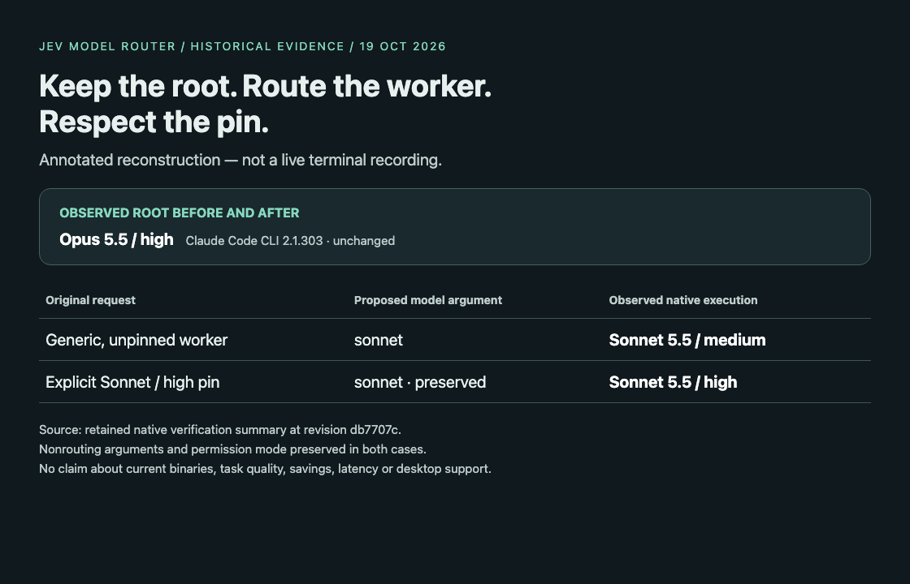

# Jev Model Router

### Keep the orchestrator. Route the work.

Choose a model **and** reasoning effort for delegated coding work in **Claude Code
and Codex**, without changing the main session’s choices.
[Jev by TypeSafe](https://github.com/typesafe-ai/typesafe-sdk-python) classifies the assignment; a local, inspectable policy decides
whether a supported worker route is appropriate. Explicit pins stay yours.

<picture>
  <source media="(max-width: 600px)" srcset="assets/public/routing-overview-mobile.svg">
  
</picture>

[Open full-size overview](assets/public/routing-overview.svg)

[Get started](docs/installation.md) · [Configuration](docs/configuration.md) ·
[Routing rationale](docs/routing-rationale.md) · [Demonstration](docs/demo.md)

## Why route delegated work?

A repository search, a focused implementation and a security-sensitive review do
not need the same treatment. A fixed worker model ignores that difference;
hand-written routing instructions leave the choice to the orchestrator.

Jev Model Router separates **task assessment** from **execution policy**. It aims
to make worker selection explicit and repeatable—not to promise that a smaller
model is always sufficient or that routing improves quality, latency or cost.

## What it does

- **Classifies generic assignments** into task requirements, using Jev’s external
  classifier rather than asking it to choose your runtime model directly.
- **Selects model and effort separately**, with task tiers, risk floors, confidence
  checks and a runtime-specific supported catalog.
- **Preserves the main session**, explicit worker model/effort pins, custom profiles,
  nonrouting arguments and native permission decisions.
- **Abstains safely** on unsupported mappings, missing consent, stale capabilities,
  conflicting integrations or provider failures. Native behavior continues.
- **Makes decisions inspectable** with offline explanation, privacy preview,
  diagnostics and bounded local telemetry.

## Benchmark-informed, not benchmark-validated

The policy’s model/effort priors were informed by
[Artificial Analysis](https://artificialanalysis.ai/) benchmark comparisons.
Benchmarks are a starting point for a policy—not proof of the right route for
every task, a live leaderboard integration, or measured savings for this router.

Read the [routing rationale](docs/routing-rationale.md) for the task classes,
independent effort choices, source provenance and limits. API price comparisons
are not measurements of subscription quota consumption. No affiliation or
endorsement by Artificial Analysis is implied.

## Start safely: inspect before enabling

Python 3.11+ is the tested CI baseline. Clone this repository and try an offline
explanation first; these commands do not install a plugin or call Jev:

```sh
git clone https://github.com/hualcosa/jev-model-router.git
cd jev-model-router
python3 scripts/router_cli.py --help
python3 scripts/router_cli.py explain --help
```

Follow the [installation guide](docs/installation.md) for an isolated smoke test,
pinned SDK dependency, private key/config paths, package generation and explicit
native installation. **Do not use the root `install.sh` for the Jev router**: it
belongs to the retained legacy heuristic plugin.

Automatic routing is opt-in. Building an artifact does not enable it, grant
trust or authorize sending real assignments to an external classifier.

## See the routing boundary



This is an **annotated reconstruction of retained historical evidence**, not a
fresh terminal recording or a quality/cost comparison. The
[demonstration and text equivalent](docs/demo.md) distinguish requested arguments
from observed native execution, and describe its version and evidence limits.

## How it works

<picture>
  <source media="(max-width: 600px)" srcset="assets/public/routing-flow-mobile.svg">
  
</picture>

[Open full-size decision flow](assets/public/routing-flow.svg)

1. Recognize an eligible generic delegated assignment and check consent.
2. Minimize the task description before the external Jev request.
3. Apply local policy to the returned task requirements.
4. Resolve an explicitly supported model/effort mapping.
5. Pass the proposal through the native integration—or abstain.

**Claude Code:** a native final-classic middleware inspects the actual classic
hook outcome before proposing worker routing. Exact-build/module attestation is
required; unknown integrations disable rewriting.

**Codex:** a preparation bridge binds the original assignment to a single-use
reference, consumed at native spawn. It does not execute a replacement worker.
Preparation is not itself evidence that a child ran with the selected settings.

## Safeguards and privacy

- No main-session model/effort switching and no permission elevation.
- Missing consent or authority means no automatic rewrite.
- Keys and runtime state belong in private external locations, not Git.
- Task descriptions sent to Jev are minimized/redacted, **not guaranteed anonymous**.
  They can still contain sensitive business context: preview them and grant only
  the consent appropriate to your work. Do not send secrets.
- Local telemetry avoids raw task/transcript content; inspect the
  [configuration guide](docs/configuration.md) for retention and control details.

## Compatibility is deliberately scoped

Historical native checks covered **Claude Code CLI 2.1.303** and **Codex CLI
0.163.0**. These are evidence baselines, not promises that an arbitrary newer
binary is supported. Claude’s exact binary and companion-module bindings are
stricter than a version string. Updates can intentionally cause abstention.

Desktop, managed-host policies, every model/effort pair and every permission mode
are **not** established by those checks. See the
[compatibility and troubleshooting guide](docs/configuration.md).

## Documentation and contributing

- [Installation and isolated checks](docs/installation.md)
- [Configuration, consent, diagnostics and rollback](docs/configuration.md)
- [Artificial Analysis-informed routing rationale](docs/routing-rationale.md)
- [Annotated functional demonstration](docs/demo.md)
- [Contributing and offline verification](CONTRIBUTING.md)
- [Security reporting](SECURITY.md)

The shared implementation lives in `router_core/`; native entrypoints and package
builders live in `scripts/`. Reusable tests and synthetic fixtures stay in `tests/`.
Internal development records are not product documentation or plugin payload.

## License and provenance

[MIT](LICENSE). This project builds on
[tzachbon/claude-model-router-hook](https://github.com/tzachbon/claude-model-router-hook).
The original heuristic plugin remains under `plugins/claude-model-router-hook/`
with its own prompts and metadata; it is distinct from the Jev-backed core and its
generated `intelligent-agent-router` package. Upstream attribution is retained.

If inspectable worker routing is useful to you, consider starring the repository.
