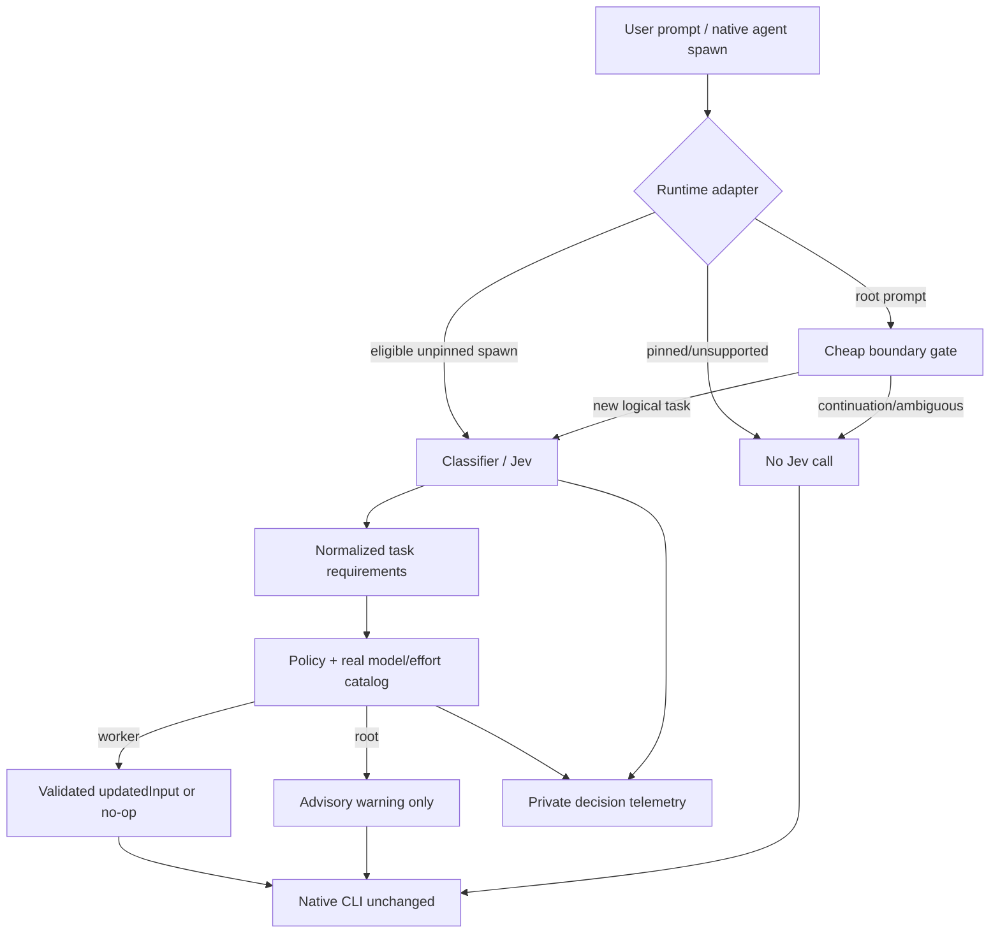

# 02 — Technical Architecture and Interfaces

## 1. Reference architecture



The **core is not an inference gateway**. It never forwards model inference tokens or replaces the official runtime. The external Jev call is only a classification request; the host remains responsible for all agent execution, authentication and permissions.

## 2. Module boundary

Suggested layout (adapt to existing Python router package rather than force unnecessary rewrite):

```text
router_core/
  contracts.py           # typed events and decisions
  boundary.py            # stateful cheap gate
  classifier.py          # Jev adapter + injectable fake
  policy.py              # model + effort decision
  catalog.py             # inventory and capability filtering
  state.py               # per-run task identity and dedupe
  telemetry.py           # structured, private events
  config.py              # schema v1 + precedence + validation
adapters/
  claude/                # hook entrypoints + registration
  codex/                 # hook entrypoints + plugin/trust integration
scripts/
  preflight.py           # explicit separate command
  explain.py             # read saved decisions
  diagnose.py            # check runtime capabilities
  uninstall.py           # rollback hooks/installation
fixtures/
tests/
```

**Runtime-language issue:** the upstream Claude hook is Python; Jev's inspected sample uses `@typesafe-ai/sdk` from Node. Spike first: determine whether TypeSafe documents a direct, stable HTTP endpoint or a Python SDK. If not, isolate a small Node-only classification subprocess with a strict JSON/stdin-stdout protocol. Do not reimplement undocumented SDK internals or run an LLM to “parse” the results. Compare startup overhead and attack surface of persistent/one-shot process.

## 3. Canonical contracts (illustrative, not actual TypeSafe API)

```typescript
interface TaskEnvelope {
  runtime: 'claude' | 'codex';
  sessionId: string;
  turnId?: string;
  taskId: string;           // stable logical ID or generated reference
  toolCallId?: string;
  event: 'root_prompt' | 'subagent_spawn' | 'preflight';
  taskText: string;         // held in memory, minimized before external call
  contextSummary?: string;  // optional, privacy-filtered; NOT full transcript
  activeRootModel?: string;
  activeRootEffort?: string;
  explicitModel?: string;
  explicitEffort?: string;
  explicitAgentType?: string; // raw type; generic defaults are not automatically pins
  hasCustomOrUnknownProfile: boolean; // adapter validates type against runtime evidence
}

interface Requirements {
  complexity: number;      // normalized 0..1, if returned by provider
  reasoning: number;
  toolComplexity: number;
  ambiguity?: number;
  risk?: 'low'|'medium'|'high';
  confidence: number;      // normalized, must be validated; not fabricated
  providerRawTier?: string;
}

interface RouteDecision {
  disposition: 'skip'|'defer'|'warn_root'|'route_worker';
  reasonCode: string;
  selectedModel?: string;
  selectedEffort?: string;
  recommendedModel?: string;
  recommendedEffort?: string;
  confidence?: number;
  catalogSource?: string;
  version: string;
}
```

Runtime tool arguments and provider payloads MUST be adapted through validated translation layers. The interface above is a design target, not the current TypeSafe output schema.

## 4. Boundary detector — cheap path first

**Observation:** a hook does not know that a prompt is a new logical task merely because it fired. Task changes may occur in the same user turn, while a continuation may contain enough task-like words to fool a heuristic. Use hierarchy:

1. **Strong structural boundaries:** explicit user `router preflight`, `TaskCreated` where Claude reports it, an **eligible new native subagent spawn**, or a user-defined `/new-task` marker. Treat each spawn as a *child task*, even during a root continuation.
2. **Strong continuation signals:** same nonexpired task ID, explicit “continue/yes/ok” acknowledgments, short follow-up linked to preceding turn, same `TaskCreated` parent reference; these are **only cheap suppressions** (no Jev).
3. **Potential new root task:** meaningful standalone prompt with changed work objective; use a lightweight, bounded deterministic gate and session state; if uncertain abstain (`unknown`) rather than pay for a second expensive semantic classifier by default.
4. **Explicit preflight:** user invokes a command/skill to force classification *before* sending the work to the active root. Preflight is the strongest UX for a human wanting to manually change model in advance.

States: `idle`, `active(taskId)`, `uncertain`, `completed`; transitions at `SessionStart/resume`, `TaskCreated`, `UserPromptSubmit`, `Stop`, `TaskCompleted`, `SessionEnd` where supported. A task may remain active across multiple turns. TTL is a safety fallback, not a reliable definition of a task. **Do not treat hash equality as semantic task identity**.

Pseudo algorithm:

```python
def root_prompt_gate(event, state):
    if event.is_router_preflight: return NEW_TASK
    if state.has_explicit_active_task and event.is_clear_continuation: return CONTINUE
    if event.is_trivial_acknowledgement: return CONTINUE
    if event.is_explicit_new_task: return NEW_TASK
    if event.has_reliable_native_task_created: return NEW_TASK
    if is_high_confidence_new_objective(event.prompt, state.last_objective): return NEW_TASK
    return UNKNOWN    # no Jev by default; optional user-initiated assessment
```

Classifying **every** `UserPromptSubmit` with Jev merely to decide whether to classify would defeat the requirement; never adopt it silently. Track false positives and false negatives using labeled turn sequences.

## 5. Classification pipeline

1. Verify key/consent and a real task boundary.
2. Remove incidental secrets, credentials and unnecessary context. Avoid trying to reconstruct full transcript.
3. Build the TypeSafe `systemOne` request from official SDK documentation/version; known `jev-router/src/router.mjs` sample uses `{state, questions}` with `choice` and `score`; do not assume exact response fields without contract test.
4. Set a **wall-clock deadline** (candidate 2.5 sec; adjust after measurement), one bounded retry if necessary; bypass on failure.
5. Normalize scores and confidence with schema validation; record unavailability separately from low confidence.
6. Return requirements, not hardwired model decision. Keep raw request/response out of normal telemetry.

Provider downgrade, missing permissions or key => `defer`; never infer that “unknown” means “simple”.

## 6. Model/effort policy algorithm

```python
def decide(envelope, req, catalog, policy):
    if envelope.explicit_model is not None or envelope.explicit_effort is not None or envelope.has_custom_or_unknown_profile:
        return skip('explicit_override')
    if not req or not catalog.routing_metadata_verified:
        return defer('classifier_or_catalog_unavailable')
    supported = filter_runtime_allowed_models(catalog, policy)
    eligible = supported.where(task_capability_floor(req, policy))
    if not eligible: return defer('no_supported_route')
    route = optimize(eligible, quality_floor=req, latency_weight=policy.latency_weight,
                     quota_penalty=policy.quota_penalty, risk=req.risk)
    if envelope.event in ('root_prompt','preflight'):
        return warn_if_material_gain(route, envelope.activeRootModel,
                                     envelope.activeRootEffort, policy)
    return route_worker(route)
```

`routing_metadata_verified` concerns exact runtime IDs/versions and supported tool/effort fields. Account availability may be accepted from the user's explicit assumption, stored separately with `availability_source: user_assumption`; do not invent an entitlement-discovery gate or label that assumption verified. Generic delegations omit model/effort at source. The adapter preserves any pin already present instead of attempting to identify who set it.

**Multiobjective ordering:** (i) schema, explicit user choices and policy restrictions, (ii) capability floor, (iii) safety/verification needs, (iv) predicted task success quality, (v) effort adjusted for task reasoning, (vi) expected completion latency / quota / API cost, (vii) model switch/cache effects and concurrency. Do not optimize “cheap” at the expense of low task-success probability.

For possible models with effort not supported by the runtime, use that model with inherited effort **only if explicitly permitted by policy**; otherwise defer the route. Do not encode unsupported effort inside prompts and describe it as actual runtime effort control.

## 7. Adapter mechanics and safe rewrite

- `PreToolUse`: accept native JSON event, validate runtime, tool name and expected schema, check explicit pins, call classifier, return `hookSpecificOutput.updatedInput` containing original args merged with **only** supported `model` and `reasoning_effort`/equivalent keys. If no valid route, stdout empty success.
- `UserPromptSubmit`: cheap task detector; only for strong new-task cases call classifier; if significant upgrade, emit supported `systemMessage` or `additionalContext` — **not an automatic model change**.
- `PostToolUse` / `SubagentStop`: read resolved execution metadata if documented; mark `actual_unverified` if unavailable.
- `PreModelSwitch` / `PostModelSwitch` (Claude): observe actual user changes and cache hints, never block model switch or reset root to a router preference.

A crucial permission caveat: some runtimes require `permissionDecision: allow` for `updatedInput`. This may bypass the approval step for the **spawn itself**. Test and document the permission impact. Never rewrite generic execution tools, or infer that it preserves every approval prompt. Downstream permissions/sandbox must remain governed by runtime.

## 8. Session state and idempotency

- State key: `(runtime, sessionId, rootOrSubagent, taskId, toolCallId)` as available.
- Atomic writes to private state directory, bounded TTL and size, no shared global mutable object across concurrent hook processes.
- Dedupe classifier calls for identical `toolCallId`; provide per-call in-flight lock where safe; detect regenerated tool IDs.
- After compaction/resume, refresh observed active root model, invalidate questionable boundary inference, retain only bounded warning fingerprints and historic decision metadata.
- Task identity scope and continuation policy must not cross unrelated projects/sessions.

## 9. Decision telemetry

Example JSONL (never include unredacted prompt):

```json
{"schema":1,"runtime":"codex","event":"subagent_spawn","session_hash":"...","tool_hash":"...","boundary":"new_child","classifier":"jev","confidence":0.92,"recommended":"gpt-.../medium","requested_model":null,"disposition":"route_worker","actual_execution":"unverified","elapsed_ms":430}
```

`actual_execution` states: `verified`, `reported_by_host`, `unverified`, `mismatch`. Only use `verified` when collected by a documented reliable runtime mechanism. `explain` uses this stored record; no provider re-call.

## 10. Security, privacy, failure modes

- External Jev classifier gets a minimized **task description**; model/effort availability may be included if permitted by consent. Even excerpts can contain sensitive IP. Provide opt-in, clear documentation and a local conservative abstain path.
- Verify what TypeSafe stores/retains in its own service; do not promise zero retention without provider documentation or contract.
- Read credentials from environment or OS secret interface; redact logs and crash output; no credential shell echo.
- Validate model ID against current verified catalog; reject path/command injection from tool inputs; do not shell-interpolate task text.
- Prevent hook recursion, repeated classifying of spawned helper processes, and hook conflicts; use explicit `ROUTER_CHILD`/disable flags.
- Respect managed hooks policy and user trust; do not instruct bypassing trust prompts.
- Rollback via feature flag or uninstall instructions must be tested before enabling global hooks.

## 11. Error handling table

| Error | Effect on agent | Telemetry |
|---|---|---|
| No Jev key/consent | Native run unchanged | `deferred_no_consent` |
| Jev timeout | Native run unchanged | `deferred_timeout` |
| Invalid provider schema | Native run unchanged | `deferred_invalid_schema` |
| No verified catalog/effort | Native run unchanged | `deferred_catalog` |
| Explicit pin/custom agent | Native run unchanged | `skipped_override` |
| Hook version incompatibility | Native run unchanged; report diagnostic | `unsupported_version` |
| Unknown task boundary | No root classification | `boundary_unknown` |
| Host ignored updatedInput | Disable auto-routing for that version | `actual_mismatch` |
| Other hook rewriting same tool | Do not assume precedence; integration test + documented conflict | `hook_conflict_possible` |
